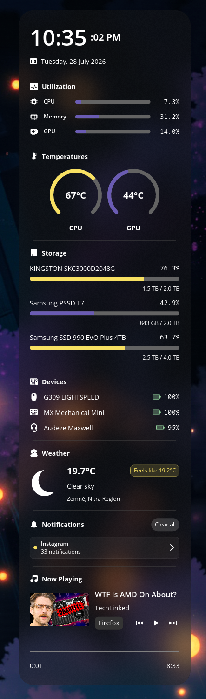

# COSMIC Widget

[Overview](README.md) | [Architecture](docs/architecture.md) | [Supported Devices](docs/supported-devices.md)



A configurable system monitor overlay for the
[COSMIC desktop](https://github.com/pop-os/cosmic-epoch).

[](https://opensource.org/licenses/MPL-2.0)

COSMIC Widget combines a panel applet, a native COSMIC settings application,
and a frosted-glass desktop overlay.

## Features

- CPU, memory, GPU, network, and disk I/O monitoring
- CPU and GPU temperatures with arc, circular, or text displays
- Local and mounted storage usage, including network filesystems
- Native battery monitoring for Logitech peripherals, gaming headsets, and the
  Razer Wolverine V3 Pro 8K PC
- Open-Meteo weather with animated Meteocons icons and no API key
- Grouped, expandable COSMIC notifications with synchronized dismissal
- Multi-source media controls for MPRIS players, Cider, Emby, and browser media
- YouTube thumbnails and Bandcamp album covers for browser playback
- Local video thumbnails and readable COSMIC Player episode titles
- Ten-second backward/forward controls for seekable media
- Compact per-player volume control for supported Cider, Emby, and MPRIS sources
- Emby Theater subtitle toggle and track selector for compatible active sessions
- Bandcamp track titles in Zen/Firefox when the playing duration uniquely
  identifies a track, without a browser extension
- AI Usage below Now Playing, with Codex and Claude remaining allowances,
  compact provider cards with horizontal meters, reset times, and report
  details on hover
- Reorderable and individually configurable sections
- COSMIC theming, accent colors, blur, rounded corners, and drag-to-position
- Cached weather, notification, storage, and battery state for fast startup

See [Supported Devices](docs/supported-devices.md) for the complete battery support
matrix.

## Install

The project requires Rust, Cargo, `just`, a COSMIC desktop session, and the
development packages needed by libcosmic and hidapi.

```bash
just build-release
sudo just install
sudo udevadm control --reload-rules
sudo udevadm trigger
```

Reconnect newly supported USB receivers after the first installation so the
udev permissions take effect. The install recipe places the applet, overlay,
settings application, desktop entries, icon, metadata, and headset udev rules
under `/usr/local`. `sudo just install` refreshes all three installed binaries
as your normal user before copying any files, including when release binaries
already exist. The separate build step is optional. Installation through `pkexec`
also builds as the invoking user. For a custom Cargo output directory, pass it
explicitly through sudo: `sudo just cargo-target-dir=/path/to/target install`.
Packagers and direct root sessions can use `just install-prebuilt` after building
as a normal user; it checks every required binary and resource before copying.

Add **COSMIC Widget** to the COSMIC panel. Its popup can show or hide the
overlay and open the settings application.

## Run From Source

```bash
cargo run --release --bin cosmic-widget-applet
cargo run --release --bin cosmic-widget-iced
cargo run --release --bin cosmic-widget-settings
```

Only one overlay instance can run at a time.

## Optional Integrations

- FFmpeg enables thumbnails extracted from local videos. Install `ffmpeg` with
  your distribution's package manager; title formatting and controls work without it.
- [COSMIC Player seeking](integrations/cosmic-player/README.md) enables the
  10-second buttons and timeline for Player versions with unimplemented MPRIS
  seek commands. Other players use their existing seek support.
- [Solaar](https://github.com/pwr-Solaar/Solaar) can be enabled as a fallback
  for Logitech hardware that the native HID++ reader cannot access.
- [HeadsetControl](https://github.com/Sapd/HeadsetControl) can provide fallback
  support for headset models newer than the built-in registry.
- Cider's local API adds direct Apple Music polling and controls. Standard
  MPRIS players work without Cider.
- [COSMIC Files transfer progress](integrations/cosmic-files/README.md) shows copy
  and move progress, then updates the same notification when the operation ends.
  This requires the included COSMIC Files companion and notification timeout patches.
- Codex usage reads local session reports and the desktop app's saved HTTP usage
  response every 30 seconds. Desktop reports must match the current account;
  newer desktop resets can update the card without new session log entries.
  Only reported percentages and reset times are shown. Old reports stay marked
  as last known, and elapsed resets wait for a new report rather than assuming
  the allowance has refilled. Desktop reads use bounded local cache files and
  account-ID metadata only, with no credentials used or extra network polling.
- ChatGPT credits appear below the allowance cards as the reported remaining
  balance (or Unlimited). These credits are shared by Codex and ChatGPT Work;
  they are separate from the subscription's percentage allowances. The widget
  uses the newer validated balance from the same local reports. Zero is shown
  only when reported; missing balances remain unavailable. Credit reports older
  than 15 minutes are marked stale, and hovering shows their age.
- Claude usage shows the five-hour and weekly allowances shared across Claude
  Desktop, web, and Claude Code. An available Claude Code sign-in provides account
  reports with reset times every five minutes, with backoff on request failures.
  Saved readings reappear immediately after widget restarts; temporary failures
  start retrying after 30 seconds, while server rate limits retain their required
  delay. Without an available Code report, the widget can read the latest complete
  usage report saved by a signed-in Claude Desktop app. It checks local metadata
  every 30 seconds; Desktop normally saves reports every 5–15 minutes. Matching
  usage responses in Desktop's HTTP cache provide the actual reset times without
  accessing credentials or making extra requests. If that cached response is
  unavailable, the widget keeps the saved percentages and labels the reset time
  unavailable. The original report age remains in the tooltip, and readings become
  stale after 20 minutes. Reports from a logged-out Desktop session are ignored.
  Sign in through Claude Desktop or Claude Code if the widget asks; it does not
  refresh or modify your credentials or make inference requests. Expired windows
  wait for a fresh report.

Toggle or reorder **AI Usage** in the widget settings. Turning it off pauses both
usage monitors. No browser extension is needed.

## Data Locations

Configuration is stored through `cosmic-config` under:

```text
~/.config/cosmic/com.github.zoliviragh.CosmicWidget/v1/
```

Runtime caches are stored under:

```text
~/.cache/cosmic-widget-applet/
```

Cached battery readings are provisional at startup and are replaced by a live
reading or the normal unavailable state.

## Development

```bash
cargo fmt --all -- --check
cargo test --all-targets
cargo clippy --all-targets
python3 tools/check_installer.py
```

The production overlay is implemented by the `cosmic-widget-iced` Cargo target
and installed as `cosmic-widget`. The older Cairo target remains in the source
tree under `src/legacy/` as migration compatibility code. All four binaries use
the shared library in `src/lib.rs`; `src/bin/` contains only their launchers.
Monitoring code lives under `src/monitors/`, production UI under `src/overlay/`,
and the applet and settings UI have their own directories. Historical prototypes
and backup snapshots are preserved under `archive/` and are not built.

See [Architecture](docs/architecture.md) for the process model, data flow, and source
layout.

## License

MPL-2.0

The ten-second media controls use Google's rounded Material Design Icons under
the Apache License 2.0. Sources and attribution are in
[assets/icons/material-design](assets/icons/material-design/README.md).

The production overlay uses animated [Meteocons](https://github.com/basmilius/meteocons)
by Bas Milius under the MIT license. Vendored sources, attribution, and frame
generation instructions are in [assets/weather/meteocons](assets/weather/meteocons/README.md).

The legacy overlay uses
[Weather Icons](https://github.com/erikflowers/weather-icons) under the SIL OFL
1.1.
